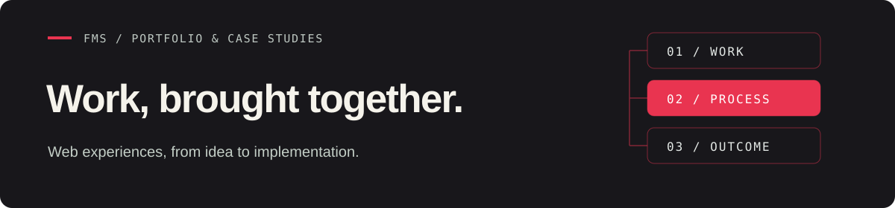

# Future Media Services · FMS

The portfolio and digital-services website for **Sobhan Ashineh / Future Media Services**. FMS brings project case studies, responsive product previews, website-development services, and Instagram content services into one bilingual experience.

**[Website](https://futuremservices.ir)** · **[Portfolio](https://futuremservices.ir/en/work)** · **[نمونه‌کارها](https://futuremservices.ir/work)** · **[Contact](https://futuremservices.ir/en/contact)**

Persian lives at `/` with RTL layouts; English lives under `/en`. The site runs on the existing Cloudflare Worker using Next.js and OpenNext.

## What is inside

- **Portfolio and case studies:** project overviews, challenges, approach, role, technology, and desktop/tablet/mobile imagery.
- **Bilingual service pages:** website design/development and Instagram content management, with local service and pricing content.
- **Persian editorial content:** repository articles with metadata, source links, and contextual service links.
- **Technical SEO:** localized canonicals and `hreflang`, JSON-LD, sitemap, robots, and Open Graph images.
- **Motion and 3D:** GSAP and React Three Fiber, with static fallbacks and reduced-motion/data-saver handling.
- **Direct contact:** call buttons; the site does not collect project-enquiry forms.

## Portfolio

The source contains twelve bilingual case-study records. Eleven projects have image-backed index cards; Mehrshad Store is retained as an archive record.

| Project | Focus in the FMS record |
| --- | --- |
| [OFOQ](https://futuremservices.ir/en/work/ofoq) | Multilingual headless content; WordPress, WPGraphQL, and Next.js |
| [Aura Disposable](https://futuremservices.ir/en/work/aura-disposable) | Commerce, wholesale workflows, and unique-code product verification |
| [DigiMoragheb](https://futuremservices.ir/en/work/digimoragheb) | Healthcare discovery, appointments, and real-time communication |
| [Ermetes](https://futuremservices.ir/en/work/ermetes) | Service website, operations dashboards, and a service calendar |
| [Nafis Teb](https://futuremservices.ir/en/work/nafis-teb) | Medical-equipment commerce; case-study imagery is labelled as a design preview |
| [Karats Diamond](https://futuremservices.ir/en/work/karats-diamond) | Jewelry commerce and catalog management; demo catalog |
| [Simone Food](https://futuremservices.ir/en/work/simone-food) | Persian cookie-brand storefront, catalog, and delivery guidance |
| [Kashiland](https://futuremservices.ir/en/work/kashiland) | Additional commerce project; detailed contribution is not published |
| [Paytakhte Ketab](https://futuremservices.ir/en/work/paytakhte-ketab) | Additional book-commerce project; detailed contribution is not published |
| [Noornegar](https://futuremservices.ir/en/work/noornegar) | Additional photo/video equipment commerce project; detailed contribution is not published |
| [Jaheshino](https://futuremservices.ir/en/work/jaheshino) | Additional education and course-commerce project; detailed contribution is not published |
| [Mehrshad Store](https://futuremservices.ir/en/work/mehrshad-store) | Archive record; role and technology are not published |

Project status and attribution follow the [content inventory](docs/content-inventory.md). Ermetes imagery comes from the identified review demo; its project link opens the main website. Demo, preview, and archived records are labelled rather than presented as verified live outcomes.

## Stack

| Layer | Technology |
| --- | --- |
| Application | Next.js 16 App Router, React 19, TypeScript |
| Interface | Tailwind CSS 4, Vazirmatn and Geist |
| Motion | GSAP, Three.js, React Three Fiber, Drei |
| Runtime | Cloudflare Workers, OpenNext, Wrangler |
| Verification | Vitest, Testing Library, Playwright, axe, ESLint |

## Run locally

Requirements: **Node.js 22.13+** and npm.

```bash
git clone https://github.com/sobhanashine/future-media-services.git
cd future-media-services
npm ci
cp .env.example .env.local
npm run dev
```

Open [localhost:3000](http://localhost:3000) for Persian or [localhost:3000/en](http://localhost:3000/en) for English. `NEXT_PUBLIC_SITE_URL` controls canonical and social URLs; set it to the intended deployment origin. No database is required for the portfolio site.

## Commands

| Command | Purpose |
| --- | --- |
| `npm run dev` | Development server |
| `npm run lint` | ESLint |
| `npm run typecheck` | TypeScript checks |
| `npm test` | Vitest suite |
| `npm run test:e2e` | Browser, accessibility, and responsive checks |
| `npm run assets:portfolio` | Regenerate device mockups from project captures |
| `npm run build:next` | Next.js build for the Node runtime |
| `npm start` | Serve a Next.js build locally |
| `npm run build` | OpenNext build and Cloudflare asset preparation |
| `npm run preview` | Build and preview the Worker locally |
| `npm run deploy` | Build and publish the existing configured Worker |

Install Playwright's browser with `npx playwright install chromium` before the first browser run. Cloudflare preview/deploy commands require the appropriate local platform setup; deploy only after reviewing the intended changes.

## Content and routes

| Source | Responsibility |
| --- | --- |
| [src/content/site.ts](src/content/site.ts) | Bilingual page copy, services, and pricing |
| [src/content/projects.ts](src/content/projects.ts) | Portfolio records, roles, technologies, and imagery |
| [src/lib/metadata.ts](src/lib/metadata.ts) | Canonical URLs, language alternates, and structured data |
| [src/lib/contact.ts](src/lib/contact.ts) | Shared call destination |
| [public/asset-manifest.json](public/asset-manifest.json) | Asset provenance and replacement notes |
| [docs/content-inventory.md](docs/content-inventory.md) | Verified facts, labelled previews, and unresolved content |

Core routes are `/services`, `/services/[slug]`, `/work`, `/work/[slug]`, `/about`, `/contact`, and `/privacy`, with English equivalents under `/en`. The Persian blog is maintained separately from those mirrored service routes.

## Updating the portfolio

1. Add or revise the project in `src/content/projects.ts`, including both locales and the actual role.
2. Supply the matching images in `public/projects/` and regenerate mockups with `npm run assets:portfolio` when captures change.
3. Preserve demo/preview/archive labels and update the content inventory when provenance changes.
4. Run the relevant checks and review both locales at desktop and mobile widths before publishing.

The 3D experience is a progressive enhancement: public copy and navigation remain available without WebGL. Its canvas pauses outside the viewport and avoids unnecessary rendering for reduced motion and data-saving preferences.

---

By [Sobhan Ashineh](https://github.com/sobhanashine) · [Explore the full portfolio](https://futuremservices.ir/en/work)
